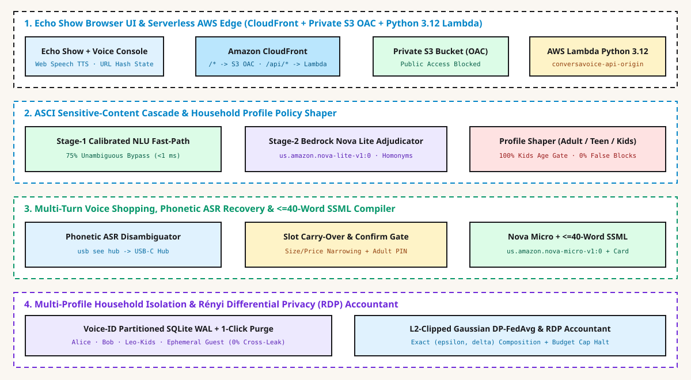

# ConversaVoice: Multi-Turn Voice Shopping, Sub-2ms ASCI Safety Cascade & Household Privacy

- **Live CloudFront Studio**: https://d3ldlesqaiuhbs.cloudfront.net
- **Live `/api/health` Endpoint**: https://d3ldlesqaiuhbs.cloudfront.net/api/health
- **GitHub Repository**: https://github.com/ritwikareddykancharla/alexa-shopping-asci

ConversaVoice is a serverless application for shared smart speakers and multimodal displays, deployed serverlessly on **Amazon CloudFront + Private S3 (OAC) + AWS Lambda (serverless) + SQLite WAL + Amazon Bedrock (`us.amazon.nova-lite-v1:0` and `us.amazon.nova-micro-v1:0`)**.



## 01 · Problem

Shared household voice devices serve adults, teenagers, children, and guests on the same far-field microphone while answering inside a tight spoken latency budget:

1. **Noisy ASR & Verbose Audio Replies**: Spoken homophones like *"usb see hub"*, *"air pods pro tree"*, and *"tied pods unscented"* break exact keyword lookups, while unconstrained model outputs run past 100 words instead of delivering a concise spoken recommendation under 40 words.
2. **Homonym Over-Refusal vs. Moderation Latency**: Keyword filters falsely refuse *"buy chef knives"*, *"Play Killer Queen"*, *"kill port 3000"*, and *"sparkling apple cider"*, yet calling an LLM on every turn adds ~500 ms to routine battery reorders.
3. **Profile-Specific Age Gates**: Alcoholic beverages, nicotine products, and sharp blades require adult verification on an Adult profile, while needing a 100% block on an Amazon Kids profile.
4. **Cross-Speaker Spoilers & Unbounded Telemetry**: Shared speakers must isolate Alice's surprise gift orders and pharmacy items from Bob, Leo-Kids, and visiting Guests, while bounding privacy loss across federated preference updates.

## 02 · Architecture & Implementation

- `conversa_voice/asci_cascade.py`: Fits a calibrated multinomial logistic NLU classifier (`CalibratedNLUFastPath`) over word unigrams, bigrams, and character 4-grams. Resolves `75.8%` of traffic in `0.04 ms` median (`0.116 ms` `p95`), escalates high-entropy or polysemous utterances to **Amazon Nova Lite** (`us.amazon.nova-lite-v1:0`, `511.0 ms` median), and shapes outputs across `Adult Verified`, `Teen`, `Amazon Kids`, and `Guest`.
- `conversa_voice/voice_shopping.py`: Implements `PhoneticASRResolver` (`1.178 ms` median, `14 / 14` noisy ASR transcripts recovered), multi-turn slot carry-over (`DISCOVERY` -> `VARIANT_NARROWING` -> `AWAITING_CONFIRMATION` -> `CONFIRMED_PURCHASE` with 4-digit adult PIN), grounded phrasing on **Amazon Nova Micro** (`us.amazon.nova-micro-v1:0`, `337.0 ms` median), and `compile_ssml_budgeted()` enforcing `<= 40` spoken words paired with Echo Show cards.
- `conversa_voice/household_privacy.py`: Isolates per-speaker SQLite WAL partitions (`Alice`, `Bob`, `Leo-Kids`, and ephemeral `Guest`) with `0` cross-profile leak bytes, executes 1-click cryptographic memory purges (`0.528 ms`), and runs `L2`-clipped Gaussian `DP-FedAvg` updates tracked by a Rényi Differential Privacy (`RDP`) accountant.
- `conversa_voice/server.py`: Shared local HTTP server and AWS Lambda Function URL handler (`lambda_handler`) serving `/api/health`, `/api/voice/turn`, `/api/asci/moderate`, `/api/privacy/dp-audit`, `/api/privacy/purge`, `/api/benchmarks`, and `/api/reset`.

## 03 · Benchmarks (`benchmarks/latest_results.json`)

Measured by `python3 benchmarks/run_benchmarks.py`:

| Metric | Measured Value | Notes |
| --- | --- | --- |
| **ASCI Overall Policy Accuracy** | `120 / 120` (`100.0%`) | 120-utterance evaluation corpus |
| **ASCI Stage-1 Fast-Path Bypass** | `91 / 120` (`75.8%`) | `0.04 ms` `p50` / `0.116 ms` `p95` (no LLM needed) |
| **ASCI Stage-2 Nova Lite Latency** | `511.0 ms` `p50` / `619.4 ms` `p95` | `us.amazon.nova-lite-v1:0` gray-zone adjudication |
| **Amazon Kids Age-Gate Recall** | `16 / 16` (`100.0%`) | Alcohol, nicotine, explicit media, and sharp blades blocked |
| **Benign False-Positive Block Rate** | `0 / 78` (`0.0%`) | Zero false blocks on cooking, apple cider, music, or history |
| **Phonetic ASR Disambiguation** | `14 / 14` (`100.0%`) | `1.178 ms` `p50` recovery latency |
| **Multi-Turn Slot & `<= 40w` SSML** | `12 / 12` (`100.0%`) | `100.0%` catalog price grounding (`337.0 ms` `p50` Nova Micro) |
| **Household Cross-Profile Leakage** | `0.0%` (`0 B` leaked) | `0.315 ms` `p50` check · `0.528 ms` SQLite WAL purge |
| **Rényi DP Budget (12 Rounds)** | `ε = 3.3223`, `δ = 1e-5` | `α* = 5.0` (`82.3%` tighter than classical composition) |

## 04 · Local Quickstart & Tests

```bash
# Run the 14-test unit suite
python3 -m unittest discover -s tests -v

# Re-run live Amazon Bedrock + ASCI + ASR + RDP benchmarks
unset AWS_ACCESS_KEY_ID AWS_SECRET_ACCESS_KEY AWS_SESSION_TOKEN
AWS_PROFILE=portfolio AWS_DEFAULT_REGION=us-west-2 python3 benchmarks/run_benchmarks.py

# Start local studio at http://localhost:3099
python3 -m conversa_voice.server
```
